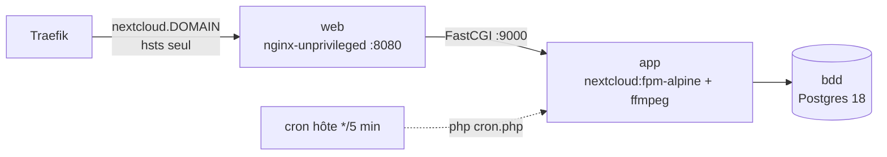

[← Accueil](../README.md) · **Nextcloud**

# ☁️ Nextcloud

Cloud personnel (fichiers, agendas, contacts, News) sur `nextcloud.<DOMAIN>`,
public. On utilise l'**image communautaire** et non Nextcloud AIO : AIO pilote
ses propres conteneurs via le socket Docker et se configure dans sa propre UI,
ce qui est incompatible avec un fonctionnement non-root et une infra décrite
par du code.



| Service | Détail |
|---|---|
| `bdd` | Postgres, majeur figé (`postgres:18-alpine`), données sous `${DATA_ROOT}/.nextcloud/bdd/18/docker`. Un des deux seuls services avec `cap_add` (démarre root puis descend). |
| `app` | build local (`nextcloud/app/Dockerfile`) : image FPM + `ffmpeg` pour les aperçus vidéo. Webroot sous `${DATA_ROOT}/.nextcloud/nexcloud`. |
| `web` | nginx non-root avec le `nginx.conf` officiel ; porte les en-têtes de sécurité |

## Au quotidien

```sh
docker exec -u "$PUID" nextcloud-app-1 php occ <commande>   # occ
make update STACK=nextcloud     # pull + rebuild + maintenance occ (voir ci-dessous)
```

`make update STACK=nextcloud` enchaîne après la recréation :
`app:update --all`, `db:add-missing-columns/indices/primary-keys` et
`maintenance:mimetype:update-*`, une fois `app` **healthy** (`up --wait`) :
l'entrypoint fait lui-même son `occ upgrade` sur une nouvelle image, d'où le
`start_period` de 10 min de `app`. Le cron interne (`cron.php`) est lancé par
le crontab de l'hôte toutes les 5 minutes.

**Stockages externes** (dossiers de l'hôte à exposer dans Nextcloud) :
`nextcloud/docker-compose.override.yml`.

## Changer de majeur Postgres

L'image est figée sur un majeur : Postgres ne relit pas le répertoire de
données d'un autre majeur. Fait pour 15 → 18 le 2026-11-13 (2 Go, ~5 min
d'arrêt). L'ancien dossier reste en place jusqu'à validation : c'est le
retour arrière.

```sh
docker exec -u "$PUID" nextcloud-app-1 php occ maintenance:mode --on
( umask 077; docker exec nextcloud-bdd-1 sh -c 'pg_dumpall -U "$POSTGRES_USER"' > dump.sql )
make down STACK=nextcloud
# docker-compose.yml : image postgres:<N>-alpine (et le montage si l'image l'impose)
make rebuild STACK=nextcloud SERVICE=bdd            # bdd seul, cluster neuf
docker exec nextcloud-bdd-1 sh -c 'dropdb -U "$POSTGRES_USER" nextcloud'   # base vide de POSTGRES_DB
docker exec -i nextcloud-bdd-1 sh -c 'psql -q -U "$POSTGRES_USER" -d postgres' < dump.sql
# un dump ne transporte pas les statistiques du planificateur : les recalculer
docker exec nextcloud-bdd-1 sh -c 'vacuumdb -U "$POSTGRES_USER" --all --analyze-only'
make up STACK=nextcloud
docker exec -u "$PUID" nextcloud-app-1 php occ maintenance:mode --off
```

Vérifier en comparant avant/après le nombre de tables et de lignes de
`oc_filecache`. Seule erreur attendue à l'import :
`role "postgres" already exists`. Puis supprimer le dump (il contient les
hachages de mots de passe) et, après quelques jours, l'ancien dossier.

> [!WARNING]
> Depuis l'image 18, `PGDATA` vaut `/var/lib/postgresql/<majeur>/docker` et on
> monte **`/var/lib/postgresql`** : l'entrypoint refuse un montage sur
> l'ancien `/var/lib/postgresql/data`.

## Flux de l'app News

Rafraîchis par le job interne de News (`OCA\News\Cron\UpdaterJob`, toutes
les heures), exécuté par `cron.php`. Vérifier :
`occ news:updater:job` (date du dernier passage) — attention, cette date
avance même quand le job ne fait rien (voir pièges).

Il n'y a plus de conteneur `news-updater` (retiré le 2026-09-29) : l'image
`kr3ssh/nextcloud-news-updater` n'avait pas bougé depuis 7 ans, échouait en
boucle (404/504), et doublait le job interne.

> [!WARNING]
> Le job interne ne fait rien si `useCronUpdates` est faux, réglage qu'un
> updater externe impose. Il doit valoir `1` :
> `occ config:app:get news useCronUpdates`.

## Pièges connus

- **502 après un `make up` qui ne recrée que `app`** : nginx (`web`) résout
  `app` une fois au démarrage et garde son ancienne IP. Corrigé le 2026-09-29
  (`depends_on: app: restart: true` sur `web`) ; sur une version antérieure,
  `make restart STACK=nextcloud`.

- **Pas de `security-headers` Traefik sur Nextcloud.** Son contrôle de
  sécurité exige `X-Robots-Tag: noindex,nofollow` et `X-Frame-Options:
  sameorigin` à l'identique, et le middleware partagé les écrasait. Les
  en-têtes viennent de `nextcloud/web/nginx.conf`. Attention au piège nginx :
  un `add_header` dans une `location` annule tous ceux du bloc `server`, d'où
  leur répétition dans les `location` des assets.
- **Renommer le service Postgres ne suffit pas** : `POSTGRES_HOST` n'est lu
  qu'à l'installation, une instance en place prend `dbhost` dans
  `config.php`. Vécu en renommant `db-next` en `bdd` (2026-11-13). Fix : y
  changer `dbhost` (conteneur `app` arrêté, `occ` ne démarre pas sans base).
  Un snapshot restauré d'avant cette date pointe encore vers `db-next`.
- **Changer de domaine** : `occ config:system:set trusted_domains …` et
  `overwrite.cli.url`, jamais en éditant `config.php` à la main.
- **Une mise à jour majeure peut désactiver une app** dont `max-version` est
  dépassée (vécu avec News en passant à NC 35). Vérifier
  `occ app:list` après chaque saut de version majeure.
- **Plus aucun article dans News, sans erreur** : `useCronUpdates` resté à
  faux (hérité de l'ancien `news-updater`, vécu du 2026-09-29 au
  2026-10-02). `UpdaterJob` passe chaque heure, met sa date à jour, mais sort
  aussitôt (durée 0 dans `occ background-job:list`). Fix :
  `occ config:app:set news useCronUpdates --value=true --type=boolean`
  (confirmer par `yes`).
- **`admin_audit` est désactivée** : elle suit le `loglevel` global (à 2) et
  jetait donc ses événements. Ne la réactiver qu'avec un `log.condition`
  dédié.
- **Secret « introuvable » alors que le montage est bon** : c'est en général
  le `cap_drop` qui empêche de le lire (voir plus haut). Ne jamais élargir les
  permissions du secret.
