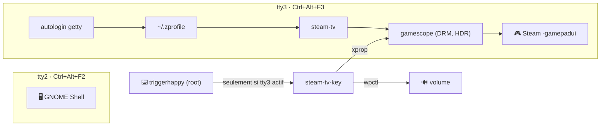

# steam-tv/ — Steam Big Picture sur une console virtuelle

Steam Big Picture seul sur **tty3**, sous [gamescope](https://github.com/ValveSoftware/gamescope)
(comme sur un Steam Deck), à côté de la session GNOME sur tty2. HDR, VRR,
manettes, clavier AZERTY et touches multimédia. Comme [`kodi/`](../kodi/) et
[`gnome/`](../gnome/), ce n'est pas un service de la stack : c'est un réglage
**poste de salon**.

Testé sur Ubuntu avec GNOME 50, gamescope 3.16, Radeon RX 9070 (RDNA 4), TV
4K HDR en HDMI.



## Installation

Depuis un **vrai terminal** (SSH ou terminal GNOME), car `sudo` demande le mot
de passe :

```sh
make steam-tv-install
```

| Côté | Fichier installé | Source |
|---|---|---|
| utilisateur | `~/.local/bin/steam-tv` (lien) | `steam-tv` |
| utilisateur | bloc ajouté une fois à `~/.zprofile` | `zprofile.snippet` |
| root | `/etc/systemd/system/getty@tty3.service.d/autologin.conf` | `systemd/getty@tty3-autologin.conf` |
| root | `/etc/systemd/system/triggerhappy.service.d/root.conf` | `systemd/triggerhappy-root.conf` |
| root | `/etc/triggerhappy/triggers.d/steam-tv.conf` | `triggers.conf` |
| root | `/usr/local/bin/steam-tv-key` (**copie**) | `steam-tv-key` |

La partie root est dans `install-root.sh` (paquets `triggerhappy` et
`x11-utils`). Elle se relance sans risque après une modification du dépôt.
`steam-tv-key` est **copié**, pas lié : triggerhappy l'exécute en root, il ne
doit pas rester modifiable par l'utilisateur.

Prérequis : `gamescope` et Steam installés, shell de login **zsh** (le bloc va
dans `~/.zprofile`).

> [!WARNING]
> L'autologin ouvre ta session sans mot de passe sur tty3 : quiconque est
> devant l'écran a accès au compte. Rien ne démarre au boot : la session
> s'ouvre au premier `Ctrl+Alt+F3`.

## Utilisation

| Action | Comment |
|---|---|
| Aller dans Big Picture | `Ctrl+Alt+F3` |
| Revenir à GNOME | `Ctrl+Alt+F2` |
| Relancer après une sortie de Steam | `steam-tv` (ou `exit`, l'autologin relance) |
| Journal | `~/.local/state/steam-tv.log` |

La bascule prend environ 1 s : les deux sessions restent ouvertes. Le son suit
(PipeWire est commun). Un jeu laissé sur tty3 continue de tourner, sans être
affiché.

**Une seule instance de Steam par utilisateur.** Si Steam tourne dans GNOME,
`steam-tv` propose de le fermer (`steam -shutdown`) avant de lancer gamescope.
Tant que Big Picture tourne sur tty3, pas de Steam dans GNOME.

**Mises à jour du client** : un seul client pour les deux sessions
(`~/.steam`). Il télécharge en arrière-plan et applique au redémarrage :
bouton *Redémarrer* de la notification, ou au prochain lancement.

### Bouton de télécommande (input-remapper)

Deux boutons, un par sens. Sortie dans input-remapper :

| Bouton | Sortie |
|---|---|
| → Big Picture | `Control_L + Alt_L + KEY_F3` |
| → bureau | `Control_L + Alt_L + KEY_F2` |

Une seule touche qui bascule dans les deux sens est impossible ici :
input-remapper ne sait pas quelle console est active.

## HDR

`gamescope --hdr-enabled`, puis *Paramètres → Affichage → HDR* dans Big
Picture. Un jeu SDR n'est pas délavé : gamescope le place correctement dans le
signal HDR. `DXVK_HDR=1 %command%` (options de lancement) ne sert qu'à un jeu
HDR dont l'option reste grisée.

### Le curseur « luminosité » de GNOME et son équivalent

| | GNOME 50 (mutter) | gamescope |
|---|---|---|
| Ce que c'est | facteur du **blanc de référence** (10–210 %, 100 % = 203 nits) | luminance du **contenu SDR**, en nits |
| Contenu touché | tout ce que GNOME compose | SDR seulement (UI de Steam, jeux non HDR) |
| Réglage par défaut | — | 400 nits (`--hdr-sdr-content-nits`) |
| En ligne de commande | D-Bus `org.gnome.Mutter.DisplayConfig`, propriété `Backlight`, méthode `SetBacklight` | propriété X `GAMESCOPE_SDR_ON_HDR_CONTENT_BRIGHTNESS` sur la racine du Xwayland de gamescope (float 32 bits stocké en `CARDINAL`) |
| Dans l'interface | curseur HDR, touches luminosité | *Luminosité du contenu SDR* de Big Picture |

Aucun des deux n'envoie quoi que ce soit à la TV : c'est un réglage logiciel du
compositeur. Un jeu HDR garde sa propre luminosité, à régler dans ses options.

## Clavier

- **AZERTY** : gamescope ne lit pas la disposition de GNOME et démarre en
  QWERTY US. `steam-tv` force `XKB_DEFAULT_LAYOUT=fr`,
  `XKB_DEFAULT_VARIANT=latin9`. À changer si la disposition GNOME change
  (`gsettings get org.gnome.desktop.input-sources sources`).
- **Touches multimédia** : sous GNOME, c'est GNOME qui les traite ; sous
  gamescope, personne. triggerhappy lit les claviers et appelle
  `steam-tv-key`, qui **ne fait rien si tty3 n'est pas la console active**
  (sinon GNOME et lui agiraient en double).

| Touche | Effet sur tty3 |
|---|---|
| Volume + / − | ±5 % (plafond 100 %), `wpctl` sur la sortie par défaut |
| Muet | bascule |
| Luminosité + / − | ±25 nits sur le contenu SDR, entre 100 et 1000 |

Une touche maintenue répète. Pas d'indicateur à l'écran. Le curseur de Steam
ne suit pas les touches, et le bouger écrase leur réglage.

## Pièges connus

| Symptôme | Cause | Solution |
|---|---|---|
| Clavier en QWERTY sur tty3 | XKB de gamescope = US par défaut | `XKB_DEFAULT_*` dans `steam-tv` |
| Touches multimédia sans effet sur tty3 | rien ne les gère hors de GNOME | triggerhappy (cette page) |
| Une touche ne fait rien | le clavier envoie un autre code | `sudo thd --dump /dev/input/event*`, puis adapter `triggers.conf` |
| Touches mortes après branchement d'un clavier ou démarrage d'input-remapper | thd en `nobody` (défaut du paquet) ne rouvre pas les nouveaux périphériques | override `triggerhappy-root.conf` (`--user root`) |
| `sudo: A terminal is required` | `make steam-tv-install` lancé sans vrai terminal (ex. prompt `!` de Claude Code) | le lancer en SSH ou dans un terminal |
| Steam refuse de démarrer sur tty3 | Steam déjà ouvert dans GNOME | `steam-tv` le ferme ; sinon le quitter depuis GNOME |
| Retour au shell de tty3 après une mise à jour | Steam s'est arrêté au lieu de se relancer, gamescope avec lui | `steam-tv` |

> [!NOTE]
> Après une montée de version de gamescope, si la luminosité ne répond plus,
> revérifier le nom de la propriété :
> `DISPLAY=<DISPLAY du process steam> xprop -root | grep -i sdr`.
