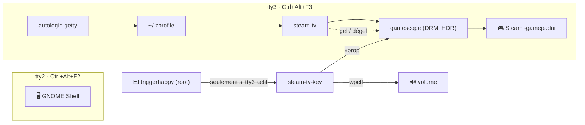
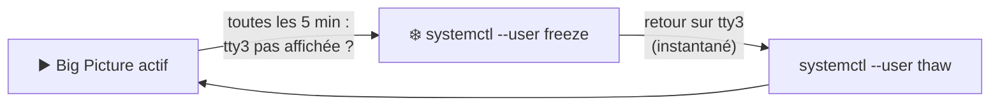

# steam-tv/ — Steam Big Picture sur une console virtuelle

Steam Big Picture seul sur **tty3**, sous [gamescope](https://github.com/ValveSoftware/gamescope)
(comme sur un Steam Deck), à côté de la session GNOME sur tty2. HDR, VRR,
manettes, clavier AZERTY, touches multimédia et presse-papiers partagé avec
GNOME. Comme [`kodi/`](../kodi/) et [`gnome/`](../gnome/), ce n'est pas un
service de la stack : c'est un réglage
**poste de salon**.

Testé sur Ubuntu avec GNOME 50, gamescope 3.16, Radeon RX 9070 (RDNA 4), TV
4K HDR en HDMI.



## Installation

Depuis un **vrai terminal** (SSH ou terminal GNOME), car `sudo` demande le mot
de passe :

```sh
make steam-tv-install
```

| Côté | Fichier installé | Source |
|---|---|---|
| utilisateur | `~/.local/bin/steam-tv` (lien) | `steam-tv` |
| utilisateur | bloc ajouté une fois à `~/.zprofile` | `zprofile.snippet` |
| utilisateur | presse-papiers partagé, lancé par `steam-tv` depuis le dépôt | `steam-tv-clipboard` |
| root | `/etc/systemd/system/getty@tty3.service.d/autologin.conf` | `systemd/getty@tty3-autologin.conf` |
| root | `/etc/systemd/system/triggerhappy.service.d/root.conf` | `systemd/triggerhappy-root.conf` |
| root | `/etc/triggerhappy/triggers.d/steam-tv.conf` | `triggers.conf` |
| root | `/usr/local/bin/steam-tv-key` (**copie**) | `steam-tv-key` |

La partie root est dans `install-root.sh` (paquets `triggerhappy`,
`x11-utils` et `xclip`). Elle se relance sans risque après une modification du dépôt.
`steam-tv-key` est **copié**, pas lié : triggerhappy l'exécute en root, il ne
doit pas rester modifiable par l'utilisateur.

Prérequis : `gamescope` et Steam installés, shell de login **zsh** (le bloc va
dans `~/.zprofile`).

> [!WARNING]
> L'autologin ouvre ta session sans mot de passe sur tty3 : quiconque est
> devant l'écran a accès au compte. Rien ne démarre au boot : la session
> s'ouvre au premier `Ctrl+Alt+F3`.

## Utilisation

| Action | Comment |
|---|---|
| Aller dans Big Picture | `Ctrl+Alt+F3` |
| Revenir à GNOME | `Ctrl+Alt+F2` |
| Relancer après une sortie de Steam | `steam-tv` (ou `exit`, l'autologin relance) |
| Journal | `~/.local/state/steam-tv.log` |

La bascule prend environ 1 s : les deux sessions restent ouvertes. Le son suit
(PipeWire est commun). Un jeu laissé sur tty3 est mis en pause avec Steam (voir
[Pause hors de tty3](#pause-hors-de-tty3)).

**Une seule instance de Steam par utilisateur.** Si Steam tourne dans GNOME,
`steam-tv` propose de le fermer (`steam -shutdown`) avant de lancer gamescope.
Tant que Big Picture tourne sur tty3, pas de Steam dans GNOME.

**Un Steam gelé compte aussi** : tant que Big Picture est en pause sur tty3,
Steam ne s'ouvre pas dans GNOME. Repasser par `Ctrl+Alt+F3` puis quitter
Steam depuis Big Picture.

**Mises à jour du client** : un seul client pour les deux sessions
(`~/.steam`). Il télécharge en arrière-plan et applique au redémarrage :
bouton *Redémarrer* de la notification, ou au prochain lancement.

### Bouton de télécommande (input-remapper)

Deux boutons, un par sens. Sortie dans input-remapper :

| Bouton | Sortie |
|---|---|
| → Big Picture | `Control_L + Alt_L + KEY_F3` |
| → bureau | `Control_L + Alt_L + KEY_F2` |

Une seule touche qui bascule dans les deux sens est impossible ici :
input-remapper ne sait pas quelle console est active.

## Pause hors de tty3

Laissé seul en arrière-plan, Big Picture continue de dessiner son interface :
**~40 W** de plus en continu (mesuré le 2026-11-09 : CPU 52 → 44 W, GPU
30-50 → 12 W, mémoire vidéo bloquée à 772 MHz au lieu de 96). `steam-tv`
gèle donc tout le groupe quand tty3 n'est plus affichée.



| | |
|---|---|
| Ce qui est gelé | le scope systemd `steam-tv.scope` : gamescope, Steam, ses sous-processus, le jeu en cours, le presse-papiers partagé |
| Mécanisme | cgroup freezer, comme une mise en veille : tout s'arrête d'un bloc |
| Gel | vérifié toutes les **5 min** (`check_every`) : jusqu'à 5 min de conso après le départ |
| Reprise | **instantanée** : ioctl `VT_WAITACTIVE` sur tty3, qui rend la main dès la bascule (repli : sondage à la seconde) |
| État | `systemctl --user show steam-tv.scope -p FreezerState` (`frozen` / `running`) |

Pendant le gel :
- Steam est **hors ligne** : ni téléchargement, ni mise à jour. Il se reconnecte
  seul au dégel.
- Un jeu solo reprend tel quel ; un jeu **en ligne** perd sa connexion.
- La mémoire vive reste occupée (1 à 2 Go).

> [!WARNING]
> Télé éteinte **en restant sur tty3** : rien n'est gelé, tty3 est toujours la
> console active (une TV éteinte reste vue « branchée » en HDMI). Revenir au
> bureau (`Ctrl+Alt+F2`) avant d'éteindre.

## HDR

`gamescope --hdr-enabled`, puis *Paramètres → Affichage → HDR* dans Big
Picture. Un jeu SDR n'est pas délavé : gamescope le place correctement dans le
signal HDR.

**`DXVK_HDR=1` est posé par `steam-tv`** pour tous les jeux lancés sur tty3.
Sans lui, DXVK et vkd3d-proton ne signalent pas l'écran HDR au jeu, dont
l'option HDR reste grisée : gamescope ne le pose pas lui-même (constaté avec
gamescope 3.16). Rien ne change sous GNOME. Pour couper le HDR d'un seul jeu :
`DXVK_HDR=0 %command%` dans ses options de lancement.

### Le curseur « luminosité » de GNOME et son équivalent

| | GNOME 50 (mutter) | gamescope |
|---|---|---|
| Ce que c'est | facteur du **blanc de référence** (10–210 %, 100 % = 203 nits) | luminance du **contenu SDR**, en nits |
| Contenu touché | tout ce que GNOME compose | SDR seulement (UI de Steam, jeux non HDR) |
| Réglage par défaut | — | 400 nits (`--hdr-sdr-content-nits`) |
| En ligne de commande | D-Bus `org.gnome.Mutter.DisplayConfig`, propriété `Backlight`, méthode `SetBacklight` | propriété X `GAMESCOPE_SDR_ON_HDR_CONTENT_BRIGHTNESS` sur la racine du Xwayland de gamescope (float 32 bits stocké en `CARDINAL`) |
| Dans l'interface | curseur HDR, touches luminosité | *Luminosité du contenu SDR* de Big Picture |

Aucun des deux n'envoie quoi que ce soit à la TV : c'est un réglage logiciel du
compositeur. Un jeu HDR garde sa propre luminosité, à régler dans ses options.

## FSR 4

**`PROTON_FSR4_UPGRADE=1` est posé par `steam-tv`**, comme `DXVK_HDR`. Au
lancement, GE-Proton télécharge le `amdxcffx64.dll` d'AMD (mis en cache) dans
le préfixe du jeu : un jeu qui propose **FSR 3.1** utilise alors FSR 4
(upscaling par IA, net, moins de fourmillement), sans rien changer dans ses
menus.

> [!NOTE]
> Garder `=1` (version par défaut de GE-Proton) plutôt qu'un numéro figé. Le
> fichier vient d'URL d'AMD qui disparaissent : constaté le 2026-11-03 avec
> GE-Proton11-1, seule la 4.0.0 répondait encore (4.0.3 et 4.1.0 en 404).
> GE-Proton se rabat alors sur la plus récente encore disponible, quel que soit
> le numéro demandé. Les versions récentes de GE-Proton suivent la liste à jour : avec
> GE-Proton11-12, `=1` donne la 4.1.1 (vérifié dans Space Marine 2).

| Condition | Ici |
|---|---|
| GPU RDNA4 (RX 9000) | RX 9070 : FSR 4 natif |
| Jeu en **FSR 3.1** (pas 2.x ni 3.0), DX12 | à vérifier par jeu |
| **GE-Proton** comme couche de compatibilité | les Proton de Valve ignorent la variable |

Vérifié en 4.1.1 : Space Marine 2 (FSR 3.1 → 4) et 007 First Light (SDK
FidelityFX 2, FSR 4 natif : il lui manquait seulement le `amdxcffx64.dll`).

Vérifier qu'il agit : `PROTON_FSR4_INDICATOR=1 %command%` affiche un filigrane
FSR 4 en jeu. Le couper pour un jeu : `PROTON_FSR4_UPGRADE=0 %command%`.

## Clavier

- **AZERTY** : gamescope ne lit pas la disposition de GNOME et démarre en
  QWERTY US. `steam-tv` force `XKB_DEFAULT_LAYOUT=fr`,
  `XKB_DEFAULT_VARIANT=latin9`. À changer si la disposition GNOME change
  (`gsettings get org.gnome.desktop.input-sources sources`).
- **Touches multimédia** : sous GNOME, c'est GNOME qui les traite ; sous
  gamescope, personne. triggerhappy lit les claviers et appelle
  `steam-tv-key`, qui **ne fait rien si tty3 n'est pas la console active**
  (sinon GNOME et lui agiraient en double).

| Touche | Effet sur tty3 |
|---|---|
| Volume + / − | ±5 % (plafond 100 %), `wpctl` sur la sortie par défaut |
| Muet | bascule |
| Luminosité + / − | ±25 nits sur le contenu SDR, entre 100 et 1000 |

Une touche maintenue répète. Pas d'indicateur à l'écran. Le curseur de Steam
ne suit pas les touches, et le bouger écrase leur réglage.

## Presse-papiers partagé

GNOME et gamescope sont deux compositeurs distincts, chacun avec son
presse-papiers. `steam-tv` lance `steam-tv-clipboard` le temps que gamescope
tourne : il copie le **texte** d'un côté à l'autre (pas les images ni les
fichiers).

- Il passe par les deux Xwayland : `:0` côté GNOME (cookie
  `/run/user/<uid>/.mutter-Xwaylandauth.*`, mutter le synchronise avec le
  presse-papiers Wayland), et celui de gamescope (le `DISPLAY` du process
  `steam`). Un client X y lit et pose la sélection sans avoir le focus.
- Sondage toutes les secondes : un copier est disponible de l'autre côté en
  1 s au plus. Si les deux côtés ont changé dans la même seconde, GNOME
  l'emporte.
- Au lancement, le presse-papiers de GNOME est recopié dans gamescope.

> [!NOTE]
> Tout texte copié passe de l'autre côté, mots de passe compris. Même
> utilisateur des deux côtés : rien n'est exposé à un autre compte.

## Pièges connus

| Symptôme | Cause | Solution |
|---|---|---|
| Clavier en QWERTY sur tty3 | XKB de gamescope = US par défaut | `XKB_DEFAULT_*` dans `steam-tv` |
| Touches multimédia sans effet sur tty3 | rien ne les gère hors de GNOME | triggerhappy (cette page) |
| Une touche ne fait rien | le clavier envoie un autre code | `sudo thd --dump /dev/input/event*`, puis adapter `triggers.conf` |
| Touches mortes après branchement d'un clavier ou démarrage d'input-remapper | thd en `nobody` (défaut du paquet) ne rouvre pas les nouveaux périphériques | override `triggerhappy-root.conf` (`--user root`) |
| `sudo: A terminal is required` | `make steam-tv-install` lancé sans vrai terminal (ex. prompt `!` de Claude Code) | le lancer en SSH ou dans un terminal |
| Steam refuse de démarrer sur tty3 | Steam déjà ouvert dans GNOME | `steam-tv` le ferme ; sinon le quitter depuis GNOME |
| Copier-coller absent entre GNOME et Big Picture | deux compositeurs, deux presse-papiers ; ou `xclip` manquant | `steam-tv-clipboard` (lancé par `steam-tv`), `make steam-tv-install` |
| Option HDR grisée dans un jeu Proton | `DXVK_HDR` absent : le jeu ne voit pas l'écran HDR | posé par `steam-tv` ; relancer `steam-tv` si Big Picture tournait avant |
| FSR 4 absent (pas de filigrane avec `PROTON_FSR4_INDICATOR=1`) | jeu sous un Proton de Valve, ou jeu en FSR 2.x/3.0 | GE-Proton dans *Propriétés → Compatibilité* ; sinon rien à faire |
| Steam ne s'ouvre pas (ou reste figé) dans GNOME | l'instance de tty3 est gelée | `Ctrl+Alt+F3`, quitter Steam depuis Big Picture |
| Big Picture figé au retour sur tty3 | le dégel n'a pas eu lieu (surveillance arrêtée) | `systemctl --user thaw steam-tv.scope` depuis GNOME ou SSH |
| Retour au shell de tty3 après une mise à jour | Steam s'est arrêté au lieu de se relancer, gamescope avec lui | `steam-tv` |

> [!NOTE]
> Après une montée de version de gamescope, si la luminosité ne répond plus,
> revérifier le nom de la propriété :
> `DISPLAY=<DISPLAY du process steam> xprop -root | grep -i sdr`.
